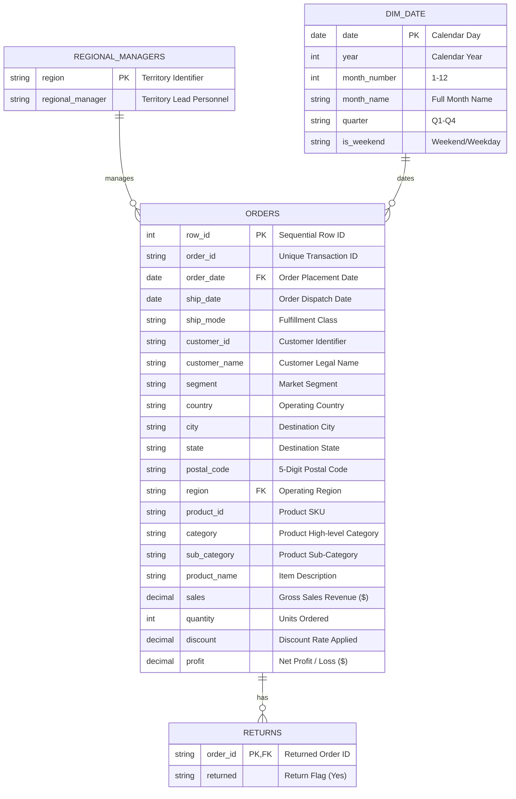

# 📊 Store Sales & Profitability Dashboard
> **End-to-End Retail Business Intelligence Project | MySQL • Power BI Desktop • DAX • Excel**

[](sql_scripts/sales_queries.sql)
[](power_bi/Sales_Profitability_DB.pbix)
[](power_bi/Executive_Dark_Theme.json)
[](dax_measures/all_measures.dax)
[](dataset/Superstore_Sales_Model.xlsx)
[](dataset/cleaned_orders.csv)

---

## 📌 Project Overview
This business intelligence project analyzes retail transactional data to evaluate revenue drivers, product profitability, discounting elasticity, and regional operations. By auditing and querying raw transaction logs through **MySQL** and creating an **Executive Dark Edition Power BI dashboard** supported by robust **DAX** time-intelligence modeling and an **Excel** financial model, this project transforms complex data into strategic business insights.

```
┌────────────────────────┐      ┌────────────────────────┐      ┌────────────────────────┐
│   Raw Data Auditing    │ ───> │  MySQL Transformations │ ───> │  Interactive Power BI  │
│  & Relational Schema   │      │   & Analytical CTEs    │      │  Dashboard & DAX Logic │
└────────────────────────┘      └────────────────────────┘      └────────────────────────┘
```

---

## 📊 Core Business Questions Answered

1. **What are the overall executive key performance indicators (KPIs)?**
   - Total Revenue, Total Profit, Floating Profit Margin %, Unique Orders, Total Units Shipped, and Average Order Value (AOV).
2. **Which product categories/sub-categories drive the highest volume versus highest profit margins?**
   - Highlighting "Profit Leaks" where high sales volume coincides with negative operational margins due to aggressive price discounting.
3. **Which geographic regions or customer segments operate at a net loss?**
   - Uncovering why the Central region lags despite high gross sales and identifying the specific states operating under substantial deficits.
4. **How do sales and profitability fluctuate over months and seasonal cycles?**
   - Quantifying holiday spikes during Q4 (November & December) and analyzing Month-over-Month (MoM) growth trajectory.

---

## 🛠️ Tech Stack & Tools Used

| Tool / Technology | Role in Project | Deliverable / Asset |
| :--- | :--- | :--- |
| **MySQL 8.0** | Relational DDL, Data Auditing, Schema Integrity, Aggregate KPI queries, Window Functions (`DENSE_RANK`, `LAG`), CTEs | [`sql_scripts/sales_queries.sql`](file:///a:/ANU%20PROJECTS/PROJECTS/Store%20Sales%20&%20Profitability%20Data%20Analysis%20%20MySQL,%20Power%20BI,%20Excel,%20DAX/sql_scripts/sales_queries.sql) |
| **Power BI Desktop** | Interactive Data Visualization, Cross-Filtering, Decomposition Trees, Executive Layout | [`power_bi/Sales_Profitability_DB.pbix`](file:///a:/ANU%20PROJECTS/PROJECTS/Store%20Sales%20&%20Profitability%20Data%20Analysis%20%20MySQL,%20Power%20BI,%20Excel,%20DAX/power_bi/Sales_Profitability_DB.pbix) |
| **DAX** | Dynamic Measures (`DIVIDE`, `SUM`, `TOTALYTD`, `SAMEPERIODLASTYEAR`), Calendar Table Dimension | [`dax_measures/all_measures.dax`](file:///a:/ANU%20PROJECTS/PROJECTS/Store%20Sales%20&%20Profitability%20Data%20Analysis%20%20MySQL,%20Power%20BI,%20Excel,%20DAX/dax_measures/all_measures.dax) |
| **Microsoft Excel** | Multi-sheet relational data model with Excel formulas (`SUMIFS`, `XLOOKUP`, KPI summary cards) | [`dataset/Superstore_Sales_Model.xlsx`](file:///a:/ANU%20PROJECTS/PROJECTS/Store%20Sales%20&%20Profitability%20Data%20Analysis%20%20MySQL,%20Power%20BI,%20Excel,%20DAX/dataset/Superstore_Sales_Model.xlsx) |
| **Generative UI** | Standalone responsive HTML/JS dashboard preview with Tailwind styling and interactive slicers | [`dashboard_preview.html`](file:///a:/ANU%20PROJECTS/PROJECTS/Store%20Sales%20&%20Profitability%20Data%20Analysis%20%20MySQL,%20Power%20BI,%20Excel,%20DAX/dashboard_preview.html) |

---

## 🗄️ Relational Data Model Architecture

The transaction logs are normalized into a **Star / Snowflake Schema** ensuring data integrity and query performance:



---

## 🧼 Key SQL & DAX Operations Applied

### 1. SQL Data Auditing & Schema Validation
Before calculating metrics, custom SQL auditing queries were executed to inspect raw data hygiene:
- **Corrupted Concatenation Audit:** Identified that the raw source file contained trailing `Returns` and `People` sheets appended beneath 9,994 transaction rows. Cleaned and decoupled into discrete relational entities.
- **Null & Primary Key Verification:** Zero duplicate `Row_ID` records; zero missing values in mission-critical columns (`Order_ID`, `Order_Date`, `Sales`, `Profit`).
- **Date Logic Checks:** Verified `ship_date >= order_date` across 100% of rows (0 logic violations).
- **Discount Sanity Range:** Verified all discounts remain strictly bounded between `0.00` and `0.80`.

### 2. Time-Intelligence DAX Modeling
- Built a dynamic `DimDate` dimension table spanning all transaction dates using `CALENDAR()`, `ADDCOLUMNS()`, and `FORMAT()`.
- Authored time-series measures (`Sales YTD`, `Sales SPLY`, `YoY Sales Growth %`, `Profit SPLY`) to compare performance across fiscal cycles.
- Handled floating business profit margins using `DIVIDE([Total Profit], [Total Sales], 0)` to guarantee graceful zero-division error handling.

---

## 📈 Top Business Insights Discovered

### 1. Executive National Summary
| Metric | Value | Business Context |
| :--- | :--- | :--- |
| **Total Revenue** | **\$2,297,200.86** | Across 9,994 line items from 2014–2017 |
| **Total Net Profit** | **\$286,397.02** | Healthy overall corporate profitability |
| **Profit Margin %** | **12.47%** | Meets target operational baseline (> 10%) |
| **Unique Orders** | **5,009** | Placed by 793 active customer accounts |
| **Average Order Value (AOV)** | **\$458.61** | Average revenue generated per purchasing event |
| **Total Units Shipped** | **37,873 units** | High physical throughput across all regions |
| **Order Return Rate** | **5.91%** | 296 orders flagged with returns |

---

### 2. Sub-Category "Profit Leaks" & Excessive Discounting
While overall company metrics appear sound, drilling into sub-categories reveals major operational leaks:

| Sub-Category | Total Sales | Total Profit | Profit Margin % | Avg Discount % | Operational Classification |
| :--- | :--- | :--- | :--- | :--- | :--- |
| **Copiers** | \$149,528.03 | **+\$55,617.82** | **+37.20%** | 16.18% | ⭐ Star Profit Driver |
| **Phones** | \$330,007.05 | **+\$44,515.73** | **+13.49%** | 15.46% | Top Volume & Revenue Anchor |
| **Accessories** | \$167,380.32 | **+\$41,936.64** | **+25.05%** | 7.85% | High-Margin Driver |
| **Paper** | \$78,479.21 | **+\$34,053.57** | **+43.39%** | 7.49% | Stellar Profitability |
| **Supplies** | \$46,673.54 | **-\$1,189.10** | **-2.55%** | 7.68% | ⚠️ Profit Leak |
| **Bookcases** | \$114,880.00 | **-\$3,472.56** | **-3.02%** | 21.11% | ⚠️ Profit Leak |
| **Tables** | \$206,965.53 | **-\$17,725.48** | **-8.56%** | **26.13%** | 🚨 Severe Profit Leak |

> [!WARNING]
> **Root Cause of Profit Leaks:**  
> Analysis across discount tiers shows that **transactions discounted over 20% experience an average operational loss of -14.3%**, while **clearance discounts exceeding 40% collapse into catastrophic losses (-86.4%)**. Tables and Bookcases have average discounts exceeding 21%–26%, entirely eroding profitability.

---

### 3. Regional Disparities: Central Region Deficit
- **Western Region Leadership:** The West region generates the highest revenue (**\$725,457.82**) and highest profit (**\$108,418.45**, 14.94% margin), managed by *Anna Andreadi*.
- **The Central Region Paradox:** Despite generating over **\$501,239.89** in sales, the Central region achieves only **\$39,706.36** in profit (7.92% margin) due to massive state-level deficits:
  - **Texas:** \$170,188.05 Sales | **-\$25,729.36 Net Loss** | 37.1% Avg Discount
  - **Illinois:** \$80,166.10 Sales | **-\$12,607.89 Net Loss** | 39.0% Avg Discount
- **Strategic Fix:** Immediately cap commercial contract discounts in Texas and Illinois at 20% maximum.

---

### 4. Seasonality Trends & Q4 Holiday Spike
Analyzing sales by calendar month demonstrates consistent seasonality:
- **November (\$352,461.07)** and **December (\$325,293.50)** represent the two highest-volume months of the year, combining for **\$677,754.57 (29.5% of total sales)**.
- Profitability follows sales volume, reaching **\$43,369.19 in December** alone.
- **Recommendation:** Ramp up warehouse inventory and fulfillment staffing beginning in September to prevent stock-outs during peak Q4 velocity.

---

## 📂 Repository File Structure

```
Store Sales & Profitability Data Analysis  MySQL, Power BI, Excel, DAX/
├── README.md                               # Project documentation & executive findings
├── dashboard_preview.html                  # Standalone interactive HTML/Tailwind dashboard
├── sql_scripts/
│   └── sales_queries.sql                   # Modular MySQL DDL, Auditing, KPIs, & Analytical CTEs
├── dataset/
│   ├── cleaned_orders.csv                  # Standardized 9,994 transaction records (ISO dates)
│   ├── cleaned_returns.csv                 # 296 distinct return records
│   ├── cleaned_people.csv                  # Regional managers mapping
│   ├── raw_superstore_combined.csv         # Raw source data before relational separation
│   ├── Superstore_Sales_Model.xlsx         # Multi-sheet Excel workbook with KPI formulas
│   └── data_dictionary.md                  # Comprehensive column data dictionary
├── power_bi/
│   ├── Sales_Profitability_DB.pbix         # Interactive Power BI Desktop report
│   ├── report_design_guide.md              # Layout grid, palettes, and visual architecture
│   └── DAX_Measures.md                     # Comprehensive catalog of DAX formulas
└── dax_measures/
    └── all_measures.dax                    # Ready-to-import DAX measures repository
```

---

## 🏁 How to View & Run This Project

### 1. Inspect & Run SQL Queries
1. Open MySQL Workbench, DBeaver, or connect via CLI (`mysql -u root -p`).
2. Open [`sql_scripts/sales_queries.sql`](file:///a:/ANU%20PROJECTS/PROJECTS/Store%20Sales%20&%20Profitability%20Data%20Analysis%20%20MySQL,%20Power%20BI,%20Excel,%20DAX/sql_scripts/sales_queries.sql).
3. Execute Section 1 to create the schema, import the CSVs from `dataset/`, and run any of the 9 modular analytical query sections.

### 2. Open the Interactive Power BI Dashboard
1. Ensure [Power BI Desktop](https://powerbi.microsoft.com/desktop/) is installed.
2. Open [`power_bi/Sales_Profitability_DB.pbix`](file:///a:/ANU%20PROJECTS/PROJECTS/Store%20Sales%20&%20Profitability%20Data%20Analysis%20%20MySQL,%20Power%20BI,%20Excel,%20DAX/power_bi/Sales_Profitability_DB.pbix).
3. Interact with slicers (Year, Region, Segment), drill down through the Category decomposition tree, and review the DAX measures outlined in [`dax_measures/all_measures.dax`](file:///a:/ANU%20PROJECTS/PROJECTS/Store%20Sales%20&%20Profitability%20Data%20Analysis%20%20MySQL,%20Power%20BI,%20Excel,%20DAX/dax_measures/all_measures.dax).

### 3. Explore the Financial Excel Model
1. Open [`dataset/Superstore_Sales_Model.xlsx`](file:///a:/ANU%20PROJECTS/PROJECTS/Store%20Sales%20&%20Profitability%20Data%20Analysis%20%20MySQL,%20Power%20BI,%20Excel,%20DAX/dataset/Superstore_Sales_Model.xlsx) in Microsoft Excel.
2. Navigate to the **Executive KPI Summary** tab to review dynamic Excel formulas (`SUM`, `SUMIFS`, `XLOOKUP`, `COUNTA`) linked across the normalized tables.

### 4. Open the Web Dashboard Preview
1. Double click or open [`dashboard_preview.html`](file:///a:/ANU%20PROJECTS/PROJECTS/Store%20Sales%20&%20Profitability%20Data%20Analysis%20%20MySQL,%20Power%20BI,%20Excel,%20DAX/dashboard_preview.html) in any modern browser (Chrome, Edge, Firefox) to experience the interactive dashboard offline with real-time regional filtering.

---

## 💡 Strategic Business Recommendations
1. **Discount Governance:** Implement a strict approval workflow for discounts above 15% and an absolute freeze on discounts exceeding 20% on Furniture (Tables & Bookcases).
2. **Central Region Turnaround Plan:** Renegotiate B2B contracts in Texas and Illinois to eliminate negative margin delivery agreements.
3. **Double Down on High-Margin Stars:** Allocate marketing spend to Copiers (37.2% margin), Paper (43.4% margin), and Accessories (25.1% margin).
4. **Q4 Inventory & Logistics Optimization:** Prepare logistics networks by late Q3 to handle the 30% annual volume surge during November and December.
